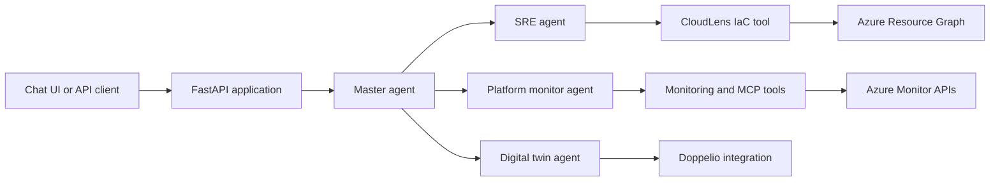

# Architecture

## System overview

## Components

- **FastAPI application** serves the chat/API surface and startup orchestration.
- **Master agent** routes requests to specialist agents.
- **SRE agent** handles infrastructure discovery and infrastructure-as-code related workflows.
- **Platform monitor agent** uses monitoring tools and Azure Monitor integrations.
- **Digital twin agent** coordinates virtual-device and load-testing workflows through the configured Doppelio integration.
- **Tool services** provide monitoring, log analysis, file operations, dashboards, RAG search, and related capabilities.

## Security considerations

- Use a local `.env` created from `.env.example`; never commit service-principal secrets, Azure OpenAI keys, or third-party API tokens.
- Grant Azure identities the minimum role permissions required for the selected workflow.
- Use production TLS verification and review external tool endpoints before deployment.
- Review generated infrastructure artifacts before applying them to cloud environments.
